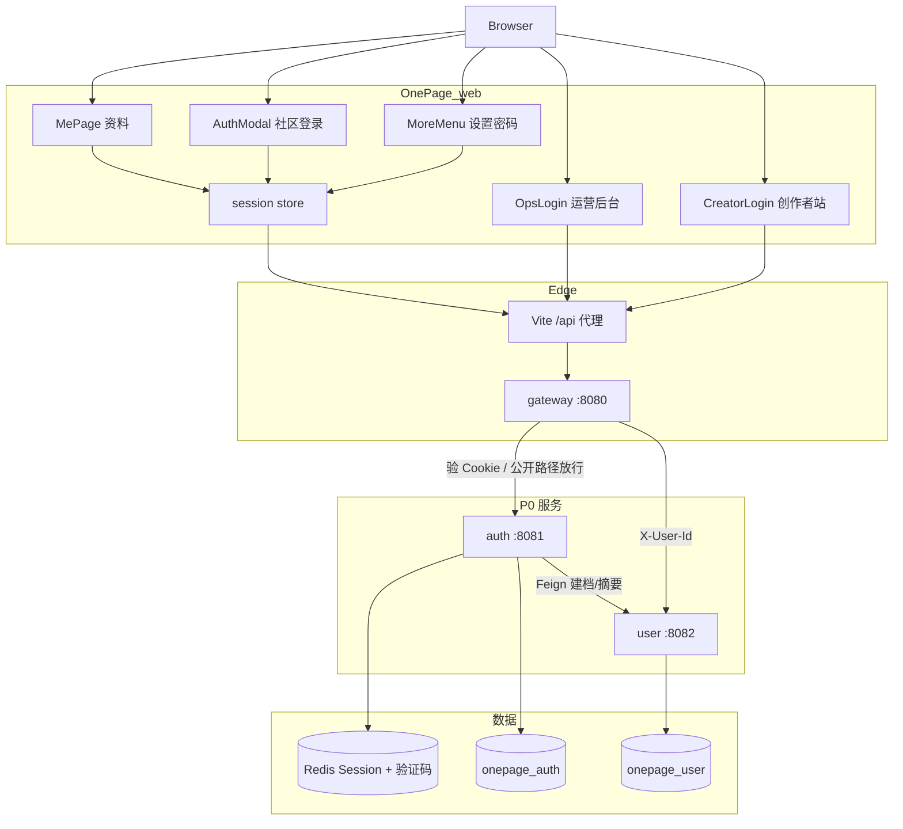
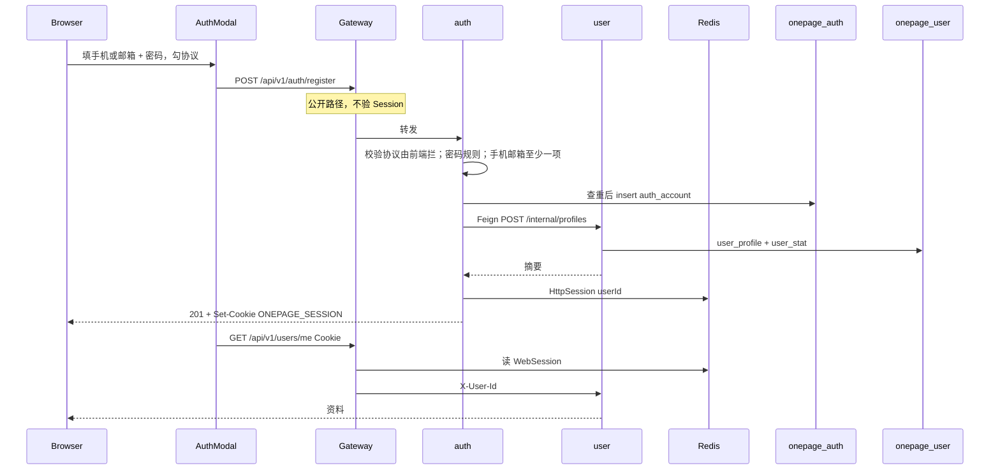
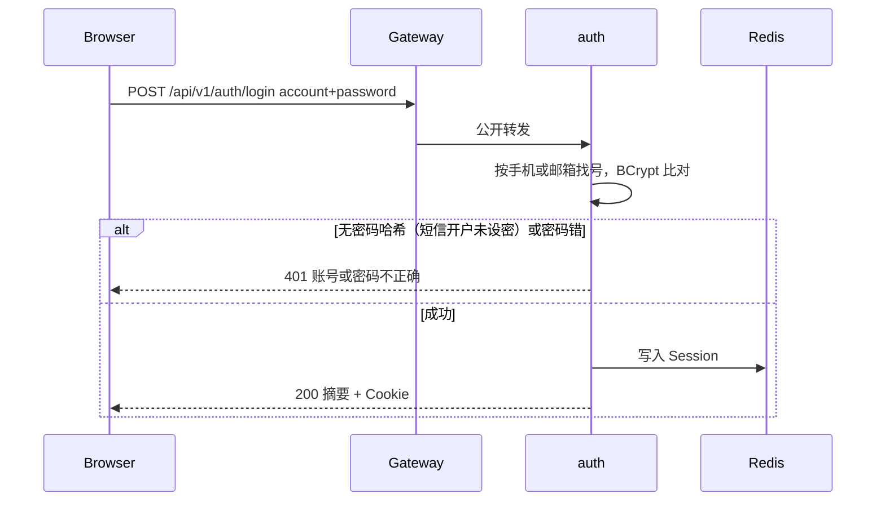
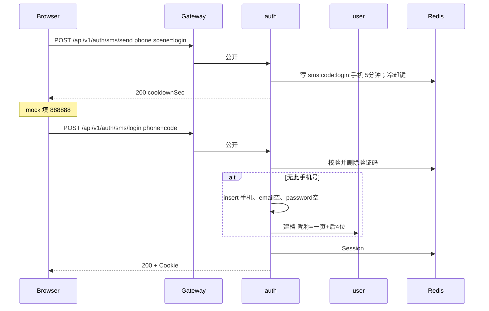
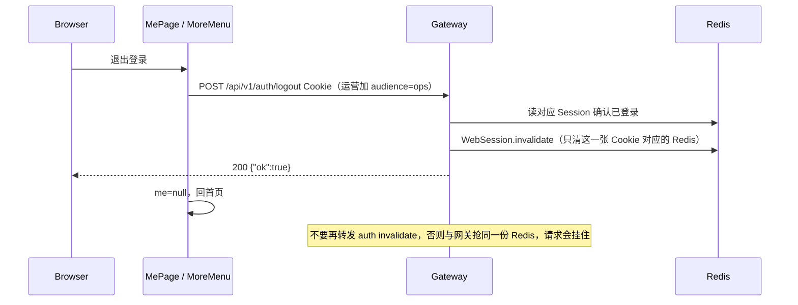
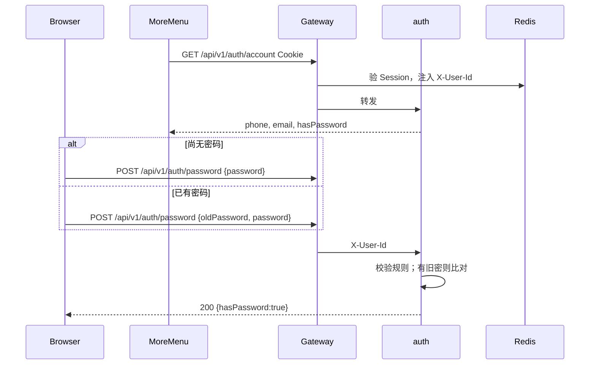
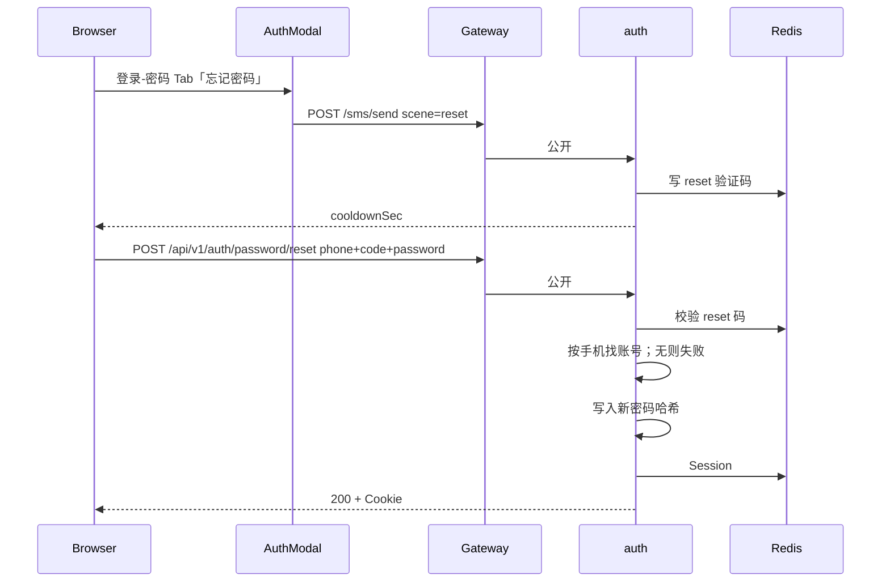

P0 **已落地**的登录、注册、短信开户、登出，以及 **设置密码 / 找回密码**。接口字段见 [API 明细](/engineering/process/api-endpoints)；Cookie 规则见 [接口契约](/engineering/process/contracts)。全景图仍在 [架构图与时序图](/engineering/tech/diagrams)。

本机短信 `onepage.sms.mock=true` 时验证码固定 **`888888`**，不调运营商。

Session 空闲超时来自环境变量 **`SESSION_TIMEOUT`（默认 7d，滑动）**。auth / 网关只靠 yml `spring.session.store-type=redis` + `timeout`，不要在启动类加 `@EnableRedisHttpSession` / `@EnableRedisWebSession`（注解默认 1800 秒会盖掉配置，Redis 里 TTL 只剩约 30 分钟，DEC-045）。Redis Hash 值**只认 JSON**（Bean `springSessionDefaultRedisSerializer`，DEC-047）。不要只改 auth 或只改网关。残留 JDK 二进制 Session 不算登录。

C 端（社区+创作者）Cookie **`ONEPAGE_SESSION`**；运营 Cookie **`ONEPAGE_OPS_SESSION`**。本机三站同 host 不同端口，Cookie 不按端口隔离；两张 Cookie 才能同时登录（DEC-046）。运营请求带 `audience=ops` 或头 `X-OnePage-Audience: ops`。

## 1. 架构（谁干什么）



| 组件 | 职责 |
| --- | --- |
| AuthModal | 社区站登录（短信 / 账密 / GitHub / Google）、注册、找回密码、协议勾选 |
| CreatorLogin | 创作者独立登录页（短信/账密）；与社区同一 Session，不注册 |
| OpsLogin | 运营独立登录；`audience=ops`；种 `ONEPAGE_OPS_SESSION`；须在 `OPS_STAFF_USER_IDS` 内，非员工 403 不种 Cookie；不注册、不短信开户 |
| MePage | 已登录设密 / 改密；资料不展示手机号邮箱 |
| Gateway | 公开：发码、短信登录、账密登录、注册、OAuth、找回密码。其余要 Session。登出在网关 `invalidate` WebSession |
| auth | `auth_account`、验证码、密码哈希、种 Session |
| user | `user_profile`（昵称、一页号）、`user_stat` |

账号表有手机 / 邮箱 / 密码哈希；资料表只有昵称等展示字段。短信开户可以 **没有密码**。GitHub / Google：已有绑定则进原号；邮箱已被占用则 **不开新号**（DEC-061），回登录提示后在「更多」绑定。邮箱空或未被占用才开户（name 作昵称，email 写入账号）。已登录 `intent=bind` 绑到当前号。无密码。不把对方头像 URL 写入 `avatar_object_key`。

## 2. 总流程图

```mermaid
flowchart TD
  Start[打开登录/注册弹窗] --> Agree{已勾选协议?}
  Agree -->|否| Tip[提示先同意协议]
  Agree -->|是| Which{做什么}
  Which --> Reg[注册]
  Which --> PwdLogin[账密登录]
  Which --> SmsLogin[手机号+验证码]
  Which --> Oauth[GitHub或Google]
  Which --> Reset[找回密码]

  Reg --> Need{手机或邮箱至少一项?}
  Need -->|否| NeedTip[提示至少填一项]
  Need -->|是| PwRule{密码 8-32 且字母+数字?}
  PwRule -->|否| PwTip[提示密码规则]
  PwRule -->|是| Dup{手机/邮箱已存在?}
  Dup -->|是| Conflict[409 已注册]
  Dup -->|否| WriteAcc[写 auth_account 含密码]
  WriteAcc --> Nick{填了昵称?}
  Nick -->|是| UseNick[用填写的昵称]
  Nick -->|否| AutoNick[一页 + 手机或邮箱后4位]
  UseNick --> Profile[user 建档 + 一页号]
  AutoNick --> Profile
  Profile --> Cookie[Redis Session + Cookie]
  Cookie --> MeHome[/me]

  PwdLogin --> Match{账号+密码对?}
  Match -->|否| Bad[401]
  Match -->|是| Cookie

  SmsLogin --> CodeOk{验证码对?}
  CodeOk -->|否| BadCode[验证码错误]
  CodeOk -->|是| HasAcc{auth 里有该手机?}
  HasAcc -->|是| Cookie
  HasAcc -->|否| AutoReg[建账号: 有手机 无邮箱 无密码]
  AutoReg --> AutoNick2[昵称 一页+手机后4位]
  AutoNick2 --> Profile2[user 建档]
  Profile2 --> Cookie

  Oauth --> Bound{已有该平台绑定?}
  Bound -->|是| Cookie
  Bound -->|否| MailHit{对方已验证邮箱已被占用?}
  MailHit -->|是| EmailTaken[回登录页提示先登已有号再绑定]
  MailHit -->|否| OauthAcc[建账号: 无手机无密码]
  OauthAcc --> OauthMail{有邮箱?}
  OauthMail -->|是| WriteMail[写入 auth_account.email]
  OauthMail -->|否| SkipMail[邮箱留空]
  WriteMail --> OauthNick[昵称用对方 name]
  SkipMail --> OauthNick
  OauthNick --> OauthBind[写 auth_oauth_binding]
  OauthBind --> Profile3[user 建档]
  Profile3 --> Cookie

  Reset --> ResetCode{reset 验证码对?}
  ResetCode -->|否| BadCode
  ResetCode -->|是| HasPhone{该手机已有账号?}
  HasPhone -->|否| NoAcc[账号不存在]
  HasPhone -->|是| SetHash[写入密码哈希]
  SetHash --> Cookie
```

### 默认值

| 情况 | 昵称 | 手机 | 邮箱 | 密码 | 之后怎么进 |
| --- | --- | --- | --- | --- | --- |
| 账密注册填了昵称 | 所填 | 所填或空 | 所填或空 | 有 | 账密或（有手机则）短信 |
| 账密注册没填昵称 | `一页` + 种子后 4 位 | 同上 | 同上 | 有 | 同上 |
| 短信登录且该号未注册 | `一页` + 手机后 4 位 | 有 | 空 | **无** | 只能再走短信，或先设密 |
| 短信登录且该号已有号 | 不变 | 有 | 原值 | 原值 | 短信；有密码则也能账密 |

## 3. 时序：账密注册



## 4. 时序：账密登录



## 5. 时序：短信登录（未注册则开户）



`scene=register` 的发码接口保留，当前弹窗发码走 `login`（登录即开户，不必先注册）。

## 6. 时序：登出



## 7. 时序：已登录设置 / 修改密码

短信开户后没有密码。在「更多」设密；已有密码则改密（要旧密码）。



## 8. 时序：找回密码（未登录）

仅已有该手机号的账号。设完后直接登录。



## 9. Gateway 公开路径（P0）

| 公开（不验 Session） | 要登录 |
| --- | --- |
| `POST /auth/sms/send` | `POST /auth/logout`（网关自己处理） |
| `POST /auth/sms/login` | `GET /auth/account` |
| `POST /auth/register` | `POST /auth/password` |
| `POST /auth/login` | `GET/PATCH /users/me` 等 |
| `POST /auth/password/reset` | |
| `GET /auth/oauth/**` | |

## 10. 前端入口

| 入口 | 行为 |
| --- | --- |
| 侧栏登录 / `/login` | 社区 AuthModal 登录 |
| 创作者站 :5175 未登录 | 整页 `CreatorLogin`，同一套 `api-client`；无账号去社区注册 |
| `/register` | AuthModal 注册 |
| 登录 · 密码 Tab · 忘记密码 | 找回（手机验证码 + 新密码） |
| 「更多」设置密码 / 修改密码 | 已登录写哈希 |
| 「更多」绑定 GitHub / Google | 已登录 `intent=bind`；已绑则灰字不可点 |
