用图说明系统边界、微服务拆分和关键流程。下文部分图含规划中的 ES / RocketMQ / SRS，**未建的不要当成已上线**。文字细节见 [技术架构](/engineering/tech/architecture)、[路线图](/engineering/tech/mvp-roadmap)。  
本工作空间 `npm run dev` 预览下 Mermaid 会自动渲染。建议顺序：**系统全景 → 微服务 → 登录 → 发帖**。  
登录/注册/短信开户/设密/找回的完整架构、流程、时序见 **[登录注册流程](/engineering/tech/auth-flows)**（P0 实况）。

## 1. 系统上下文（谁连着谁）

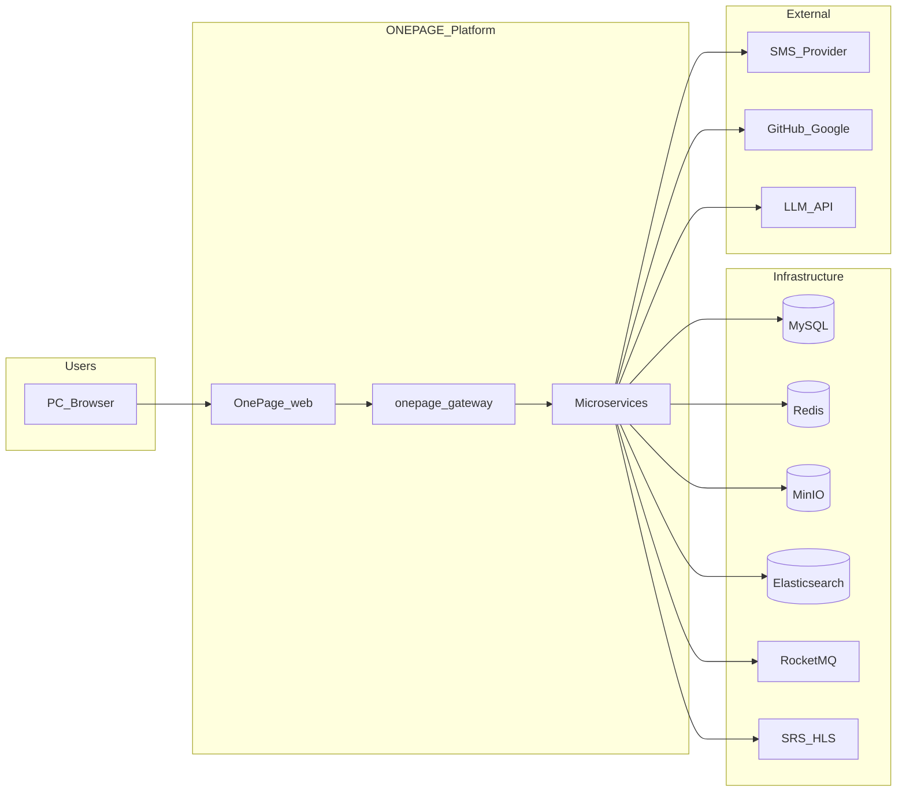

## 2. 后端逻辑架构

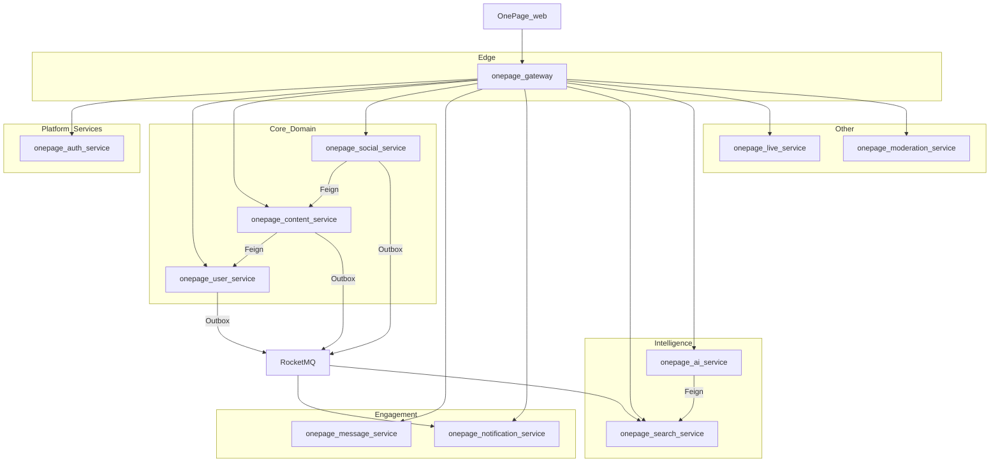

## 3. 前端微应用架构

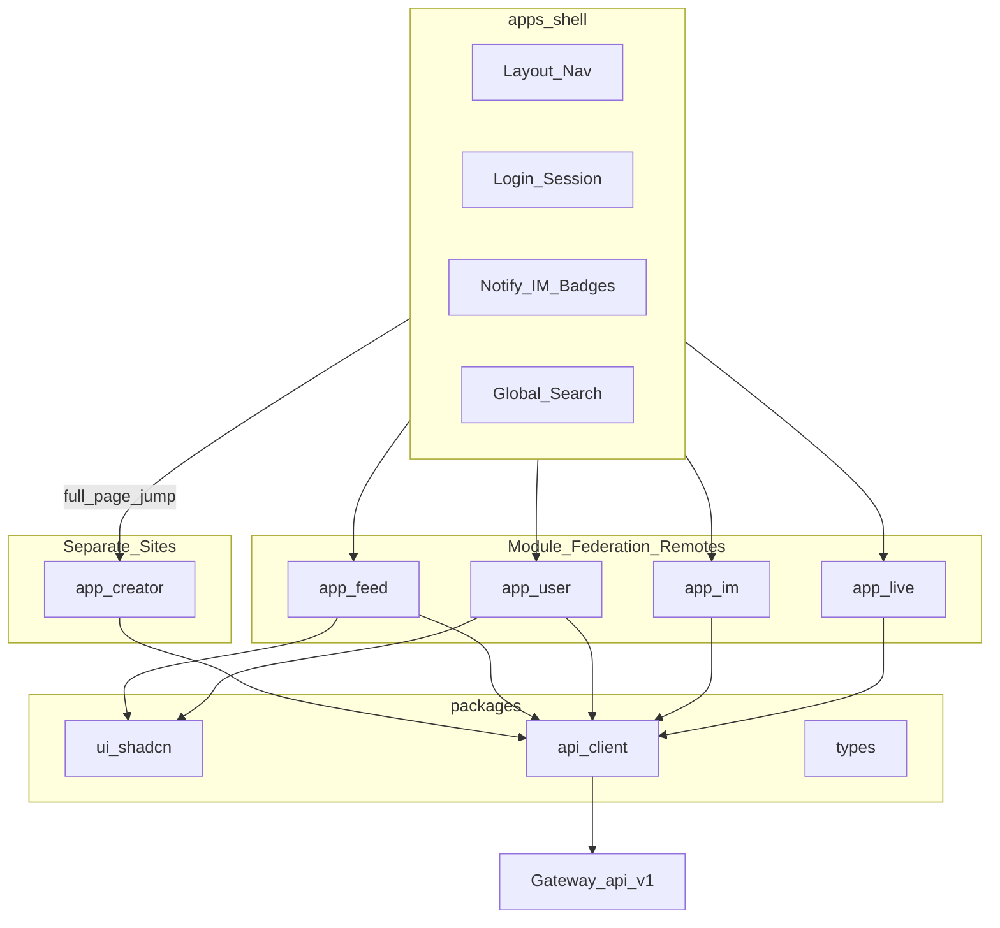

| 子应用 | 路由 | 主要 API |
| --- | --- | --- |
| shell | `/`, `/login`, `/settings` | `/api/v1/auth/**` |
| app-creator | 独立站 `/`（本机 :5175；壳 `/creator` 只跳转） | 创作者数据（P0 mock；后续 content） |
| app-feed | `/explore`, `/post/:id`, `/create` | posts, comments, reactions |
| app-user | `/u/:pageId` | users, follows |
| app-im | `/messages` | conversations, `WS /ws/im` |
| app-live | `/live` | live, `WS /ws/live` |

## 4. 时序：登录与 Session（Cookie）

概要。短信开户、注册默认昵称、登出、设密/找回见 [登录注册流程](/engineering/tech/auth-flows)。

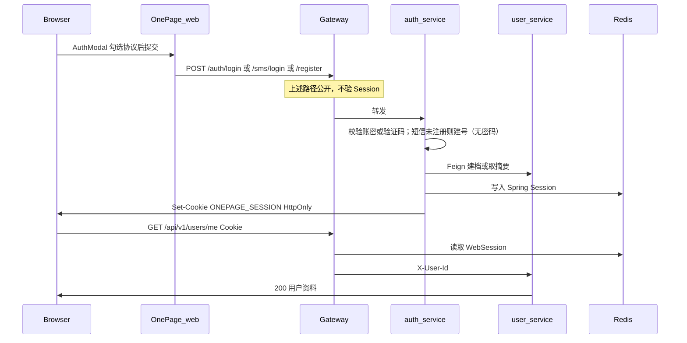

## 5. 时序：发帖 + Outbox + 搜索索引

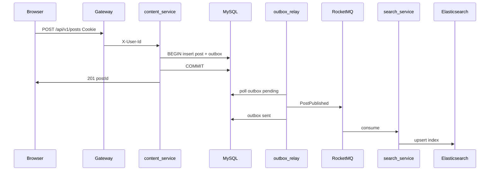

## 6. 时序：媒体上传（预签名直传 MinIO）

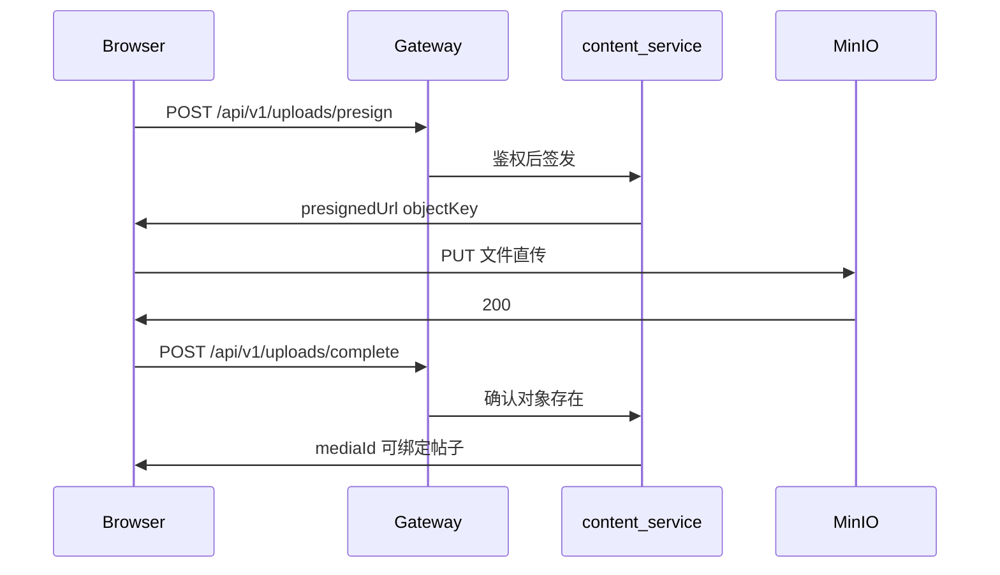

## 7. 时序：点赞 → 通知（异步）

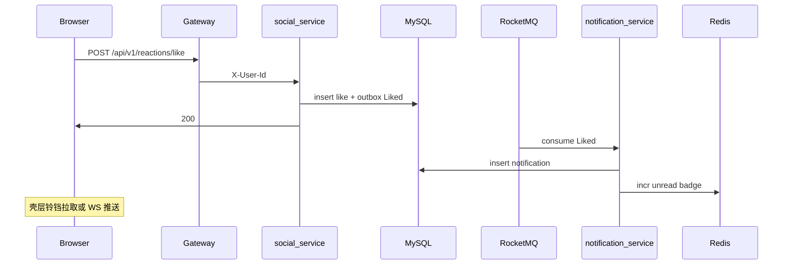

## 8. 时序：AI 助手问答（RAG）

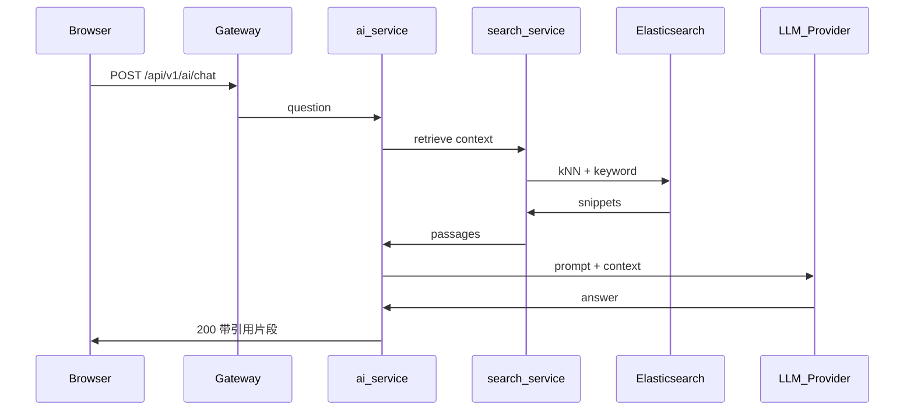

## 9. 时序：私信 HTTP（开会话 / 拉历史 / 发文本）

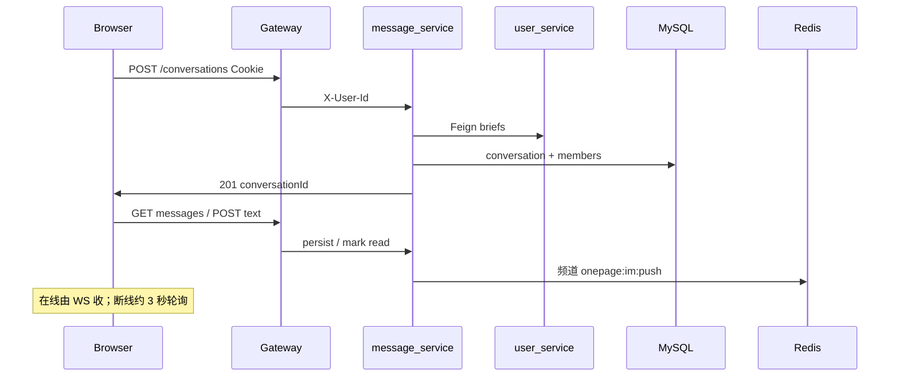

## 9c. 时序：分享笔记到私信

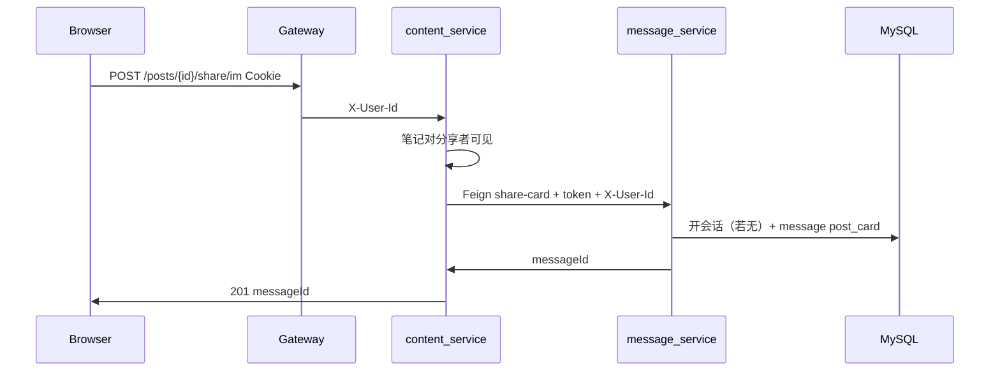

## 9b. 时序：私信 WebSocket

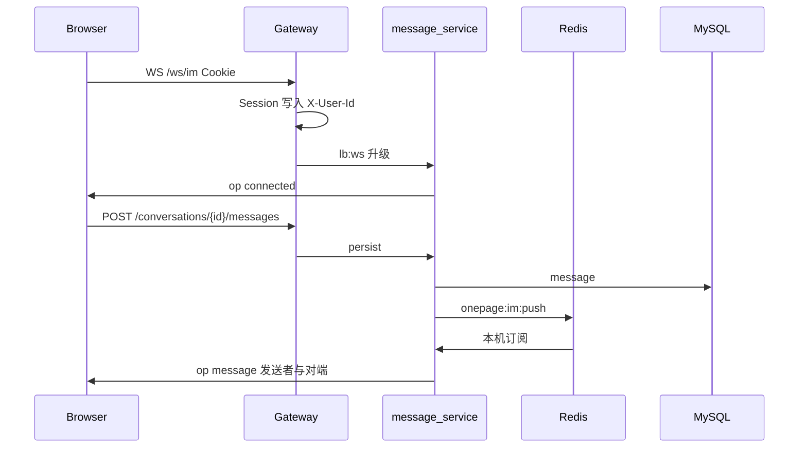

## 10. 时序：基础直播（开播 / HLS 观看）

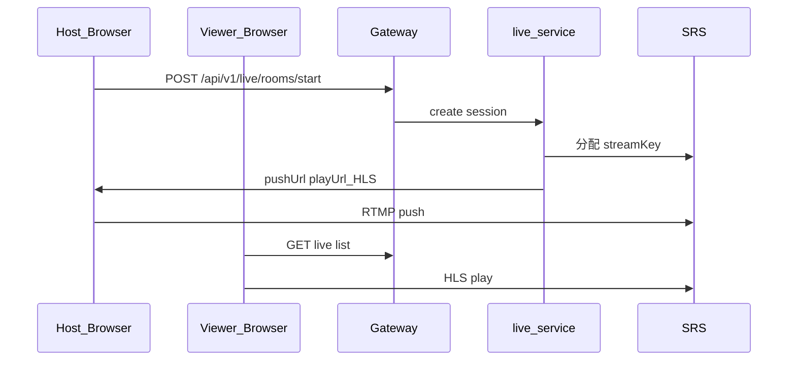

## 11. 数据存储归属（简图）

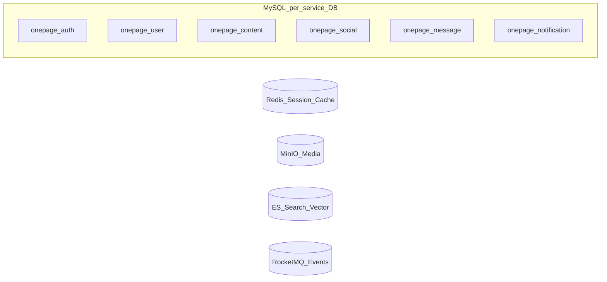

## 图例与约定

- 实线箭头：同步 HTTP / Feign / 用户请求。
- Outbox → RocketMQ：异步最终一致，见路线图「Outbox」一节。
- 生产环境：浏览器只访问 Gateway（及静态资源）；业务服务不对外暴露端口。
