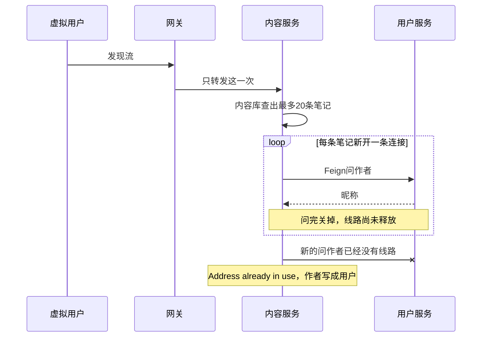

100 个并发刷发现流时，内容服务为每张卡片单独请求用户服务拉作者，本机 TCP 临时端口被打满。k6 看到约 67.4% 的 HTTP 失败，发现流返回 200 只有约 16%。单人冒烟仍是 200，所以功能测试过了，这一轮阶梯加压没过。

状态：已验收。级别：P1。发现日期：2026-10-30。脚本：`loadtest/read-ramp.js`。2026-10-31 内容服务已按 [DEC-078](/records/decisions) 使用连接池。限流放开后的同一份阶梯加压（见 [LT-002](/quality/loadtest/bugs/lt-002) 验收）HTTP 失败率 0%，用户服务 CPU 到过约 3.9 核，问作者的请求有打到用户服务。脚本只检查状态码，没有逐条核对昵称是不是「用户」。发现流正常路径见 [架构图与时序图](/engineering/tech/diagrams) 第 12 节。

## 结论

k6 打到发现流之后，网关只把这一次转到内容服务。内容服务自己的库没问题，笔记已经查出来。接着它用 Feign 按每条笔记去问用户服务要作者。默认客户端问一次就新开一条连接，问完关掉，关掉后这条线路还要占一会儿。上一次还没释放，同一时间新的问作者请求又来了，线路被占满，新连接建不起来，日志是 `Address already in use`。

Feign 没有配「到了多少次就拒绝」。对同一个用户服务，默认大约只留下 5 条可复用连接，多出来的照样新建、用完即关。所以一百个并发仍会打出大量短连接。用户服务进程当时还在，挤满的是内容服务打向它的这些短连接。

笔记已经在内容库里，发现流不是整页没数据。拨不出去的那条作者被写成「用户」。拖太久、k6 已经放弃的请求，网关侧才是超时和 `Connection reset`。一个人刷一页时，20 条连接来得及释放，冒烟仍是 200。

线上是同一段代码。一百个真人同时打开一页，不一定马上复现 k6 这种不停空转；连接不复用还在，流量集中到一台内容服务上时仍会再出现。



## 当次场景

本机 Windows，网关 `http://127.0.0.1:8080`。登录在 k6 `setup` 里做一次，各虚拟用户复用同一张 `ONEPAGE_SESSION`。每个迭代依次打：

1. `GET /api/v1/feeds/explore?limit=20`
2. 从返回里随机取一条 `GET /api/v1/posts/{postId}`
3. 该笔记的评论列表
4. 作者主页

并发阶梯：0 → 20（爬 30 秒、保持 3 分钟）→ 50（同样）→ 100（同样）→ 0（30 秒）。约 11 分钟。通过线是 HTTP 失败率 < 1%、检查通过率 > 99%。

同一天更早的 `loadtest/read-smoke.js`（1 并发、1 次迭代）登录、发现流、详情、评论、主页 5/5 为 200。低并发把端口回收掉了，看不出这个问题。

## 结果

| 观察 | 记录 |
| --- | --- |
| HTTP 失败率 | 约 67.4%，超过 1% 通过线 |
| 发现流检查 `explore 200` | 约 16% |
| 发现时刻 | 阶梯进入高并发后，内容服务 13:24:48 起连续打出拉作者失败 |
| 进程 | 网关 18596，用户服务 34664，认证 9276，内容服务 21192。四个进程都还在，Nacos 注册也还在 |

失败集中在发现流。发现流一旦不是 200，脚本就不再打详情、评论和主页，所以后面几个接口的失败不能单独当成它们自己的瓶颈。

## 日志

内容服务（PID 21192）同一用户被刷了很多次，中间省略号是重复行：

```text
WARN c.onepage.content.service.AuthorLookup : 拉作者摘要失败 userId=359393933795329：Address already in use: getsockopt executing GET http://onepage-user-service/internal/profiles/359393933795329/summary
```

用户服务当时是起来的。这条不是「服务没注册」，而是本机已经没有可用临时端口，新的 TCP 连接在 `getsockopt` 失败。

同一时段网关（PID 18596）：

```text
WARN reactor.netty.channel.FluxReceive : [..., L:/127.0.0.1:8080 - R:/127.0.0.1:...]
An exception has been observed post termination
java.net.SocketException: Connection reset
```

这是 k6 已经把连接断开，网关还往这条连接写响应。端口耗尽把请求拖慢或拖死后，客户端超时取消，网关才成批打出 `Connection reset`。它是结果。

可以忽略的行：`A cross-cluster call occurs, consumer... provider...`。那是 Nacos 默认集群互相调用时的提示，四个服务都会打，不表示调用失败。

## 调用链

发现流 `FeedService.page` 查出一页笔记后，对每条调用 `PostService.toBrief`。`toBrief` 再调 `AuthorLookup.brief`，里面是 Feign：

`GET http://onepage-user-service/internal/profiles/{userId}/summary`

`UserClient` 只有 `@FeignClient(name = "onepage-user-service")`。内容服务依赖了 `spring-cloud-starter-openfeign`，没有接带连接池的 HTTP 客户端。默认客户端对同一目标大约只复用很少几条连接（JDK 默认约 5 条），其余每次新建，用完进入 `TIME_WAIT`，释放前不能再分配。`limit=20` 时，每一页发现流最多 20 次服务间调用；100 个虚拟用户不停翻页，本机临时端口被占满。

`AuthorLookup` 抓住异常后打 warn，并用昵称「用户」占位返回，发现流不会因为这一下整页 500。占位在 `AuthorLookup.fallback`：`nickname` 固定为「用户」，头像为空。文件是 `OnePage-Server/onepage-content-service/src/main/java/com/onepage/content/service/AuthorLookup.java`。

所以内容服务进程还在，部分响应甚至仍是 200，只是作者变成占位。k6 统计到的 67% 失败，是端口耗尽之后网关侧超时、连接重置，客户端已经拿不到正常响应。端口回收完，同样的发现流又会变回 200。

评论列表也是一条评论一次 `authorLookup.brief`，同一条链路，只是这一轮脚本在发现流失败后没有继续打评论。

## 排除了什么

压测当时还看过这些，它们不是这次失败的原因：

- 内容服务 GC：`jstat -gcutil` 正常，没有长时间 Full GC。
- Redis：压测库能连上，`rejected_connections` 为 0。会话放在 Redis，不是这次先被打满的那个资源。
- 用户服务宕机：进程在，并且已注册到 Nacos。日志里的失败原因是 `Address already in use`，不是连接拒绝或 503。

压测过程中有一个 Java 进程 CPU 到过大约 4 核。那是高并发下的占用，不能解释 `getsockopt` 这条错误。

## 影响

单用户、低并发的发现流、详情、评论、主页仍然可用，冒烟可以通过。目标并发（这一轮是 100）下读主路径大面积失败，作者昵称还会在仍返回 200 的响应里变成「用户」。按当前读压测通过线，这一轮不算通过。

## 修复方向

已按 [DEC-078](/records/decisions) 改代码，待压测验收。

内容服务 Feign 改用 HttpClient 5 连接池（`feign-hc5`）。打向用户服务的连接留着反复用。池子总连接和同一目标连接默认都是 200（`FEIGN_MAX_CONNECTIONS`、`FEIGN_MAX_CONNECTIONS_PER_ROUTE`），按 100 并发发现流留够；满了排队等空闲连接，不再新建一条用完就关。一页最多 20 次问作者这次没改。须重启内容服务后再跑 `read-ramp.js`。

复用做完，用同一份 `read-ramp.js` 再跑。通过线仍是 HTTP 失败率 < 1%、检查通过率 > 99%。内容服务日志里不应再出现 `Address already in use`，发现流作者昵称也不应成片变成「用户」。若这次已经通过、发现流仍然慢，再改用已有的 `GET /internal/users/briefs?ids=`，把一页收成一次查询。

## 复现

1. 起网关、认证、用户、内容服务，以及本机 MySQL、WSL 里的 Redis 和 Nacos。
2. 设置 `K6_ACCOUNT`、`K6_PASSWORD`，不要把密码写进脚本。
3. 执行 `k6 run loadtest/read-ramp.js`。
4. 并发爬到 50～100 时看内容服务日志是否出现 `Address already in use: getsockopt executing GET http://onepage-user-service/internal/profiles/.../summary`，并对照 k6 汇总里的 `http_req_failed` 和 `explore 200`。
