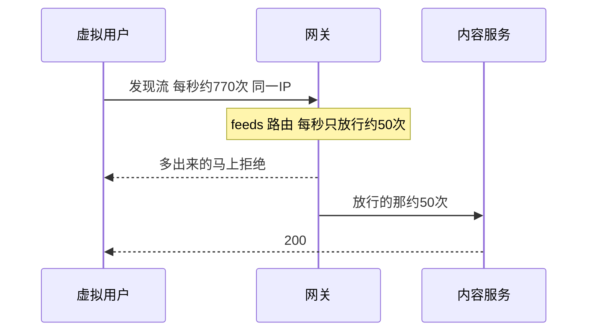

连接池改完后再跑同一份阶梯加压，HTTP 失败率仍是 83.84%。这次不是临时端口又满了。网关按客户端 IP、按路由做令牌桶，每秒补充 50 个、突发最多 100 个。k6 的虚拟用户都从 `127.0.0.1` 进来，发现流大约每秒 770 次，这条路由每秒只放行约 50 次。

状态：已验收。级别：P1。发现日期：2026-10-31。脚本：`loadtest/read-ramp.js`。上一轮端口问题见 [LT-001](/quality/loadtest/bugs/lt-001)。2026-10-31 本机把额度改成每秒补充 2000、突发 4000 并重启网关后，同一份阶梯加压 HTTP 失败率 0%。仓库模板仍是 50 和 100。

## 结论

k6 先打到网关 `:8080`。网关在转发之前扣令牌。令牌按「哪条路由 + 哪个客户端 IP」各算一份，配置是 `GW_RATE_REPLENISH=50`、`GW_RATE_BURST=100`（`env.example`；网关 `default-filters` 里的 `RequestRateLimiter`，键是 `clientIpKeyResolver`）。

这一轮四条读接口正好落在三条路由上，放行量各自钉在每秒约 50 次：

| 路由 | 脚本里的请求 | 大约每秒打进来 | 大约每秒放行 |
| --- | --- | --- | --- |
| `feeds` | 发现流 | 770 | 49 |
| `posts` | 笔记详情，然后评论 | 99（两条合在一起） | 50 |
| `users` | 作者主页 | 49 | 49 |

发现流成功之后才打后面三个。详情和评论共用 `posts` 这一份每秒 50 次，评论排在后面，所以评论大约只有 23% 是 200，详情大约 77%。作者主页自己一份额度，每秒大约 49 次，没超，所以几乎全是 200。

被拒绝的请求几十毫秒就返回。11 分钟里的突发额度摊开可以忽略，所以长时间看就是每秒 50 次。k6 汇总没有按状态码拆开，没有单独贴出 429 原文；放行量和三条路由对得上，就是这个令牌桶。

一个人正常刷发现流到不了每秒 50 次。一百个真人如果各用各的地址，每人仍有自己的每秒 50 次，不会挤在同一个桶里。挤在一起的是：本机压测、同一出口 IP 后面的很多人（公司、校园、运营商地址）。

## 当次场景

本机 Windows，网关 `http://127.0.0.1:8080`。登录在 k6 `setup` 里做一次，各虚拟用户复用同一张 `ONEPAGE_SESSION`。每个迭代依次打发现流 `limit=20`、随机一条笔记详情、该笔记评论、作者主页。发现流不是 200 就不再打后面三个。

并发阶梯与 [LT-001](/quality/loadtest/bugs/lt-001) 相同：0 → 20 → 50 → 100，每档爬 30 秒、保持 3 分钟，最后 30 秒降到 0。约 11 分 02 秒。内容服务这一轮已经是 HttpClient 5 连接池（[DEC-078](/records/decisions)）。

## 结果

| 观察 | 记录 |
| --- | --- |
| HTTP 失败率 | 83.84%（509692 / 607928），超过 1% 通过线 |
| 总请求 | 607929，约每秒 918 次 |
| 发现流 `explore 200` | 32705 通过 / 477108 失败，约 6.4%。尝试约每秒 770 次，成功约每秒 49 次 |
| 详情 `detail 200` | 25351 通过 / 7354 失败，约 77% |
| 评论 `comments 200` | 7479 通过 / 25226 失败，约 23% |
| 主页 `profile 200` | 32701 通过 / 4 失败，约 100% |
| 发现流耗时 | 中位 34.59ms，p95 273.26ms，最大 895ms |
| 进程 | 网关 13204，认证 31880，用户 20484，内容 428。四个都在 |

详情加评论的成功次数约每秒 50 次，和发现流、主页各一份额度一致。

## 排除了什么

同一轮资源采样（约 16:05 起，5 秒一次）和当时截到的控制台里，这些不是这次失败的原因：

- 临时端口：内容服务截到的日志里没有 `Address already in use`，也没有「拉作者摘要失败」。网关截到的日志里没有 `Connection reset`。控制台文件大约只留了开头 1MB，阶梯后半段的行没有留住；资源采样是全程的。
- 用户服务没被问到：用户服务 CPU 最高约 1.8 核，内存约 317MB。问作者的连接有打到用户服务。
- 内容服务或网关被 GC 拖死：内容服务 CPU 最高约 3.8 核、内存约 420MB，Young GC 约 1542 次，Full GC 为 0。网关 CPU 最高约 2.1 核、内存约 386MB，Full GC 为 0。
- Redis：`rejected_connections` 为 0，内存大约 1.4MB。
- MySQL：慢查询 0，连接数最高 31。

延迟短、失败率高、放行量按路由卡在每秒约 50 次，对得上拒绝，对不上端口耗尽那种拖死。

## 影响

单用户冒烟仍可以通过。这一份阶梯加压测不到读路径的真实吞吐：请求在网关就被掐掉，内容和用户服务只处理了放行的那一部分。按当前通过线，这一轮不算通过。[LT-001](/quality/loadtest/bugs/lt-001) 因此也还不能关。

## 修复方向

先只改本机压测用的网关额度，不改线上默认，也不拿掉限流。

本机环境变量改成 `GW_RATE_REPLENISH=2000`、`GW_RATE_BURST=4000`，重启网关，再用同一份 `loadtest/read-ramp.js`。2000 高于这一轮大约每秒 918 次的总请求，也高于发现流大约每秒 770 次，令牌桶不再先把阶梯掐死。仓库 `env.example` 和给线上的默认仍是 50 和 100。限流键继续用客户端 IP。

不要改成按用户 ID 限流来过这一轮。脚本共用一张会话，换成用户 ID 还是一个桶，发现流仍会被每秒 50 次挡住。

验收：HTTP 失败率低于 1%，检查通过率高于 99%，内容服务日志不再出现 `Address already in use`。若额度已经高于打进来的速度仍大面积失败，再记新的缺陷，不要靠继续加大限流把别的问题盖住。

## 验收

2026-10-31 约 16:47 至 16:58，本机网关已是 `GW_RATE_REPLENISH=2000`、`GW_RATE_BURST=4000`。同一份 `loadtest/read-ramp.js` 跑完 11 分 00 秒。

| 观察 | 记录 |
| --- | --- |
| HTTP 失败率 | 0%（0 / 245417），低于 1% 通过线 |
| 检查 | 100%（245416 / 245416）。发现流、详情、评论、主页都是 200 |
| 吞吐 | 约每秒 372 次请求，约每秒 93 次迭代 |
| 发现流耗时 | 中位 202.55ms，p95 386.87ms，最大 578.8ms |
| 详情 / 评论 / 主页 p95 | 283.96ms / 278.57ms / 267.6ms |
| 内容服务 | CPU 最高约 9.3 核，平均约 4.9 核，内存最高约 409MB |
| 用户服务 | CPU 最高约 3.9 核，内存最高约 176MB |
| 网关 | CPU 最高约 2.6 核，内存最高约 375MB。采样里的 jstat Full GC 为 0 |
| Redis | `rejected_connections` 为 0，瞬时命令最高约每秒 3837 次，内存约 1.4MB |
| MySQL | 慢查询 0，连接数最高 31 |

采样从 16:42:43 到 17:00 之后，盖住了这一轮。内容服务最忙，请求没有再被令牌桶掐掉。

## 复现

1. 网关沿用模板额度：每秒补充 50、突发 100。内容服务保持连接池。
2. 设置 `K6_ACCOUNT`、`K6_PASSWORD`，不要把密码写进脚本。
3. 执行 `k6 run loadtest/read-ramp.js`。
4. 看发现流成功是否停在大约每秒 50 次，详情加评论的成功是否也停在大约每秒 50 次，主页是否几乎都是 200。
